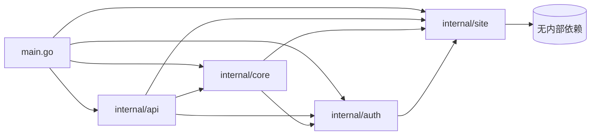
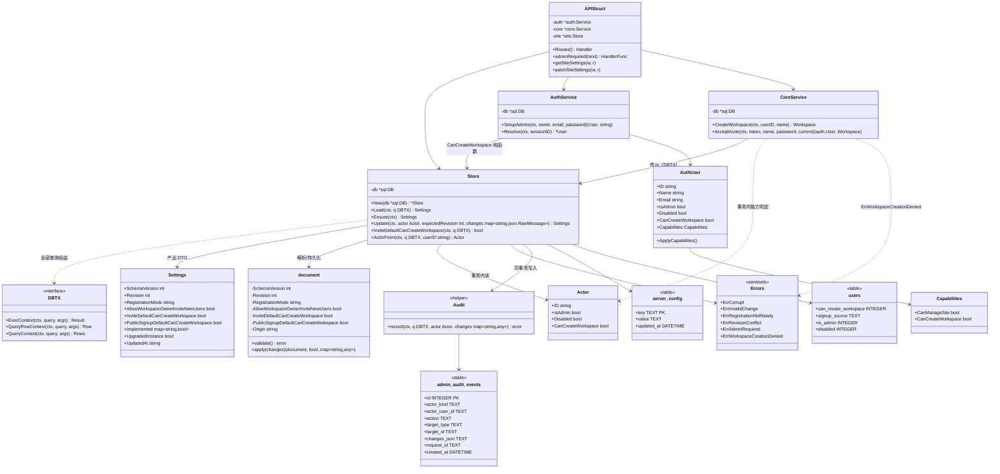
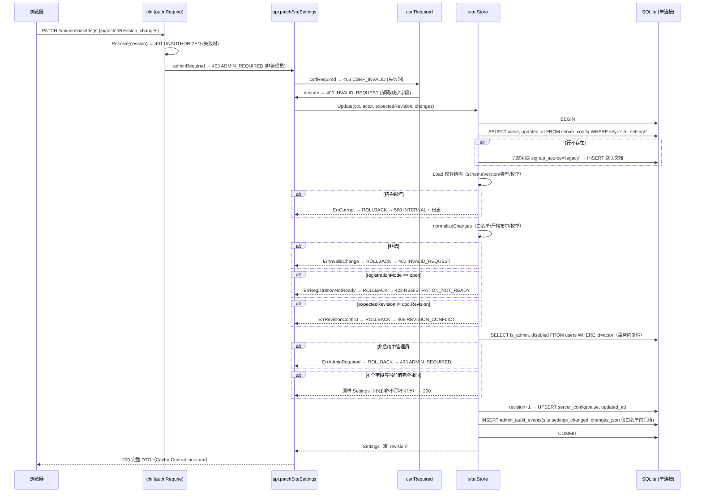
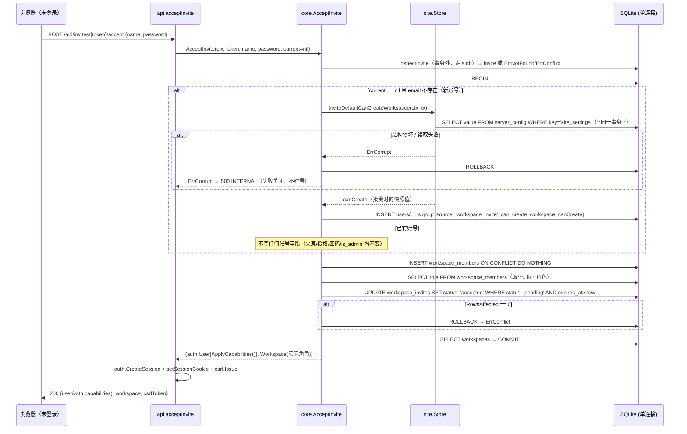
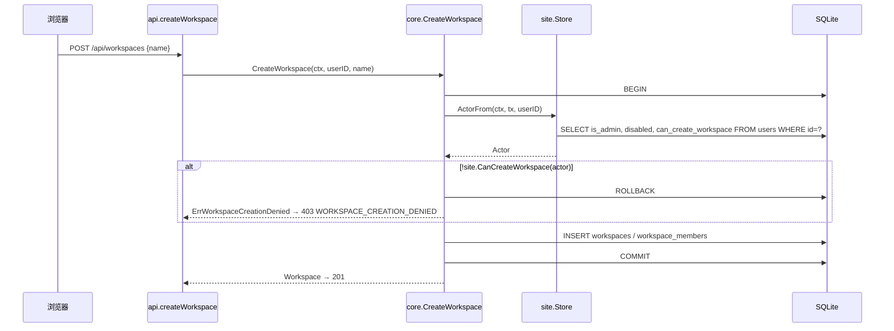
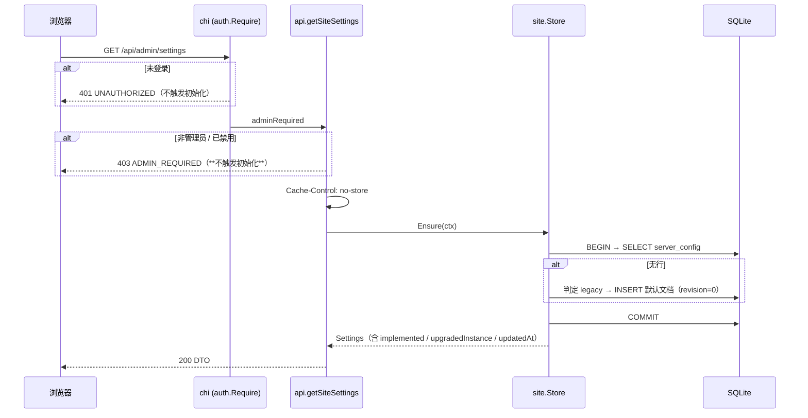
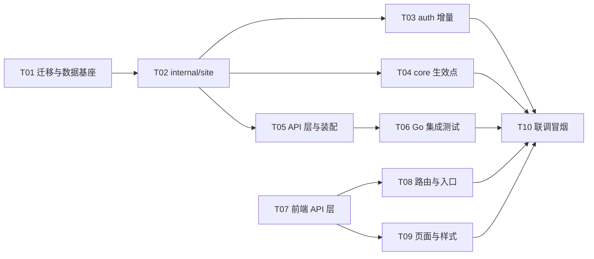

# 站点管理设置 — 系统设计与任务分解

| 项 | 内容 |
| --- | --- |
| 文档类型 | 系统架构设计 + 任务分解 |
| 上游输入 | `docs/SITE_ADMIN_SETTINGS_PRD.md`（增量 PRD，已定稿） |
| 代码基线 | `d407f98` |
| 技术边界 | `AGENTS.md` §5：只用标准库 + chi + modernc SQLite + coder/websocket；禁止 ORM / GraphQL / DI / 事件总线 / Redis / 新增依赖 |
| 交付边界 | 「设置切片 + 最小生效链路」；不含 `/admin/users`、`admin_revision`、最后管理员保护、Hub 撤权 |
| 编写人 | 高见远（架构） |

本文所有结论均已对基线代码核实；§1.3 / §2.1 的迁移草案已在真实 SQLite（modernc 驱动）上跑通验证，见 §8.1。

---

## 1. 实现方案

### 1.1 难点与决策

| # | 难点 | 决策 | 理由 |
| --- | --- | --- | --- |
| D1 | `conn.SetMaxOpenConns(1)`：持有 `*sql.Tx` 时任何走全局 `*sql.DB` 的查询都会**自锁**（`internal/db/db.go:32`） | `internal/site` 的所有读写函数**强制接受 `DBTX` 参数**，方法内部绝不回退到 `s.db`；只有 `Store.Ensure` / `Store.Update` 这两个顶层入口自己 `BeginTx` | 让"`site` 能在 `core` 事务里被调用"成为类型系统保证的事实，而不是靠注释约定 |
| D2 | 潜在循环依赖 `core → auth → site → core` | `site` 是**叶子包**：只允许 import `context / database/sql / encoding/json / errors / fmt / log / time`，**禁止 import `madoc/internal/{auth,core,api,db,account,asset,realtime}`**。`site` 需要"用户能力"时用自有 `Actor` 值对象，由 `core` / `auth` 负责把 `auth.User` 转成 `site.Actor` | 依赖图退化为单向：`api → {auth, core, site}`、`core → {auth, site}`、`auth → site`、`site → 无` |
| D3 | 设置读取失败必须**失败关闭**，不能"退回允许所有人" | `site.Load` 对结构损坏返回 `site.ErrCorrupt`；`core.AcceptInvite` 读到错误时**直接返回错误并回滚**，不建号、不猜测默认值 | PRD §4.1「损坏处理」 |
| D4 | 新安装 / 升级两套默认值，且"一旦持久化不再按用户数切换" | 迁移 `0017` 内用 `SELECT count(*) FROM users` 一次性判定并把完整 JSON（含元字段 `origin`）写入 `server_config`；Go 侧只在**行不存在**的兜底路径上判定一次 | PRD §4.1 + P0-1 |
| D5 | PATCH 的错误码有严格**优先级**（400 → 422 → 409 → 403） | 把全部业务校验放进 `Store.Update` 的事务体，按固定顺序执行；HTTP handler 只做解码与 `expectedRevision` / `changes` 存在性检查 | 保证顺序不被调用方打乱，且 Revision 校验与写回在同一事务 |
| D6 | 页面不能出现"假开关" | 服务端下发 `implemented` 映射，前端区二由该映射驱动 Badge；前端不硬编码"哪些未接入" | PRD 裁决 B |
| D7 | 事务内读设置会与 `InspectInvite` 冲突？ | `AcceptInvite` 现有的 `InspectInvite` 在 `BeginTx` **之前**执行（走 `s.db`，不持事务），事务内只做 `site.InviteDefaultCanCreateWorkspace(ctx, tx)`，不触发自锁 | 沿用现状，无需改动调用次序 |

### 1.2 `internal/site` 职责边界与依赖图



四个文件的职责（**不新增更多文件**）：

| 文件 | 职责 | 禁止 |
| --- | --- | --- |
| `settings.go` | `Store`、`DBTX`、`Settings` DTO、`document` 持久化结构、默认值、结构校验、白名单合并、`Ensure` / `Load` / `Update` | 不写任何 `users` 表语义，不做权限判断 |
| `policy.go` | `Actor` 值对象、`CanManageSite` / `CanCreateWorkspace` **纯函数**、`Store.ActorFrom`（事务内读用户能力）、`Store.InviteDefaultCanCreateWorkspace`（事务内读策略） | 不 import `auth`（`Actor` 是 site 自己的类型） |
| `errors.go` | 6 个哨兵错误 + `IsCorrupt` 等判定助手 | 不含 HTTP 状态码（映射在 `api` 层） |
| `audit.go` | `admin_audit_events` 写入 + `changes_json` 白名单裁剪 | 不含读取/查询接口（本次只写不读） |

### 1.3 `DBTX` 与事务边界（**本次最关键的设计点**）

```go
// internal/site/settings.go
type DBTX interface {
    ExecContext(ctx context.Context, query string, args ...any) (sql.Result, error)
    QueryRowContext(ctx context.Context, query string, args ...any) *sql.Row
    QueryContext(ctx context.Context, query string, args ...any) (*sql.Rows, error)
}
```

`*sql.DB` 与 `*sql.Tx` 都满足该接口（方法集一致），因此：

- `core.AcceptInvite` 在自己的 `tx` 上直接调用 `site.InviteDefaultCanCreateWorkspace(ctx, tx)` —— **复用同一条连接，不自锁**；
- `core.CreateWorkspace` 在自己的 `tx` 上调用 `site.ActorFrom(ctx, tx, userID)` 后交给纯函数判定；
- `api` 层的 GET / PATCH 不持事务，传给 `Store.Ensure` / `Store.Update` 内部事务。

**铁律（写入 §7 共享知识）**：

1. 任何函数只要签名里出现 `q DBTX`，内部**只能**用 `q`，不得触碰 `*sql.DB`；
2. 持有 `*sql.Tx` 的代码段内，**禁止**调用任何 `s.db.*`、`db.BeginTx`、以及未接受 `DBTX` 的服务方法；
3. `Store` 里只有 `Ensure` 与 `Update` 允许 `s.db.BeginTx`，且必须在返回前 `defer tx.Rollback()`；
4. **公开读取路径禁止写入**：`GET /api/site` 必须走 `Store.LoadPublic`（只读 `Load`，永不 INSERT 默认文档），**不得**复用管理端 `Ensure` 的惰性初始化。把两者统一会让未登录请求获得写库能力，这条约束必须落在 `Store` 上，而不是靠调用方自觉——因此新增的是一个独立的 `LoadPublic` 方法，而不是"调用 `Load(ctx, s.db)` 的那处代码记得别写"。

### 1.4 设置文档结构与校验

持久化文档（**元字段 `origin` 不出现在响应 DTO**）：

```go
type document struct {
    SchemaVersion                       int    `json:"schemaVersion"`
    Revision                            int    `json:"revision"`
    RegistrationMode                    string `json:"registrationMode"`
    AllowWorkspaceOwnerInviteNewUsers   bool   `json:"allowWorkspaceOwnerInviteNewUsers"`
    InviteDefaultCanCreateWorkspace     bool   `json:"inviteDefaultCanCreateWorkspace"`
    PublicSignupDefaultCanCreateWorkspace bool `json:"publicSignupDefaultCanCreateWorkspace"`
    Origin                              string `json:"origin"` // "new" | "upgrade"，仅持久化
}
```

`Load` 的校验流水线（任一步失败 → `ErrCorrupt`）：

1. `json.Unmarshal` 到 `map[string]json.RawMessage`（非法 JSON → 损坏）；
2. 必需键集合 `{schemaVersion, revision, registrationMode, allowWorkspaceOwnerInviteNewUsers, inviteDefaultCanCreateWorkspace, publicSignupDefaultCanCreateWorkspace}` 缺任一 → 损坏；
3. `schemaVersion` 严格为 int 且 `== 1`（未知结构闸门）→ 否则损坏；
4. `revision` 严格为 int 且 `>= 0`；
5. 三个布尔字段严格 `true` / `false` 字面量（先排除 `null`，再 `json.Unmarshal` 到 `*bool`）—— `0/1/"true"/null` 一律判损坏；
6. `registrationMode ∈ {closed, invite_only, open}`，否则损坏；
7. 存量 `registrationMode == "open"` → 损坏。`open` 通过枚举校验但**没有任何写入路径能存下它**：写侧对 `open` 的请求恒被 422 `REGISTRATION_NOT_READY` 拒绝，因此读到 `open` 即说明文档被服务之外的来源改写过（例如手工改库）。这道闸门必须落在**读取阶段**，读侧（`GET /api/admin/settings`）与写侧（`PATCH`）才返回同一个结论——都是 500 `INTERNAL`，GET 不会渲染一个任何修改都无法生效的值。依赖该策略的敏感操作（`AcceptInvite` 建号、`InviteDefaultCanCreateWorkspace`）随之失败关闭；
8. `origin ∈ {"new","upgrade",""}`（空值按 `new` 处理）。

> 第 6 步与第 7 步是两个层面，不要合并：`validRegistrationMode` 负责**枚举合法性**（`open` 是合法枚举值，PATCH 请求侧要用它区分 400 与 422），第 7 步负责**可达性**（服务自身写不出 `open`，所以存量 `open` 一定是外来的）。

> **明确决策**：**未知附加键忽略**（不是损坏）。`schemaVersion` 才是结构闸门；若把未知键判为损坏，未来版本写入的字段会让旧版本永久失败关闭。代价是"旧版本写回时会丢弃未知键"——本次 `site_settings` 只有本服务一个写入者，风险可接受（见 §8.4）。

### 1.5 新安装 / 升级判定

| 场景 | 判定 | 结果 |
| --- | --- | --- |
| 迁移执行时 `SELECT count(*) FROM users == 0` | 新安装 | 写入新装默认 + `origin:"new"` |
| 迁移执行时 `count > 0` | 升级 | 写入升级默认 + `origin:"upgrade"` |
| `server_config` 无 `site_settings` 行（兜底，如手工库） | `EXISTS(SELECT 1 FROM users WHERE signup_source='legacy')` | 有 `legacy` 账号 → `upgrade`，否则 `new` |

响应里的 `upgradedInstance = (origin == "upgrade")`，**读取时不再数用户**。

### 1.6 PATCH 校验顺序与错误映射

`Store.Update(ctx, actor, expectedRevision, changes)` 事务体内严格顺序：

```
BEGIN
  1. Load(ctx, tx)                        → ErrCorrupt        → 500 INTERNAL（并记日志）
  2. normalizeChanges(changes)            → ErrInvalidChange  → 400 INVALID_REQUEST
       · 键必须在 4 个业务字段白名单内（schemaVersion/revision/implemented 一律拒）
       · 布尔严格 JSON 布尔；枚举严格三值
  3. registrationMode == "open"           → ErrRegistrationNotReady → 422 REGISTRATION_NOT_READY
  4. expectedRevision != doc.Revision     → ErrRevisionConflict     → 409 REVISION_CONFLICT
  5. 事务内复检操作者（不存在/禁用/非管理员）→ ErrAdminRequired      → 403 ADMIN_REQUIRED
  6. 无实际变化（4 个字段逐一相等）        → 原样返回，不递增、不写、不审计（直接 Rollback）
  7. revision+1 → UPSERT server_config（value + updated_at）
  8. INSERT admin_audit_events（action=site.settings_changed，changes_json 仅白名单前后值）
COMMIT（任一步失败整体回滚）
```

错误码 → HTTP 映射集中在 `internal/api/api.go` 的 `domainError` switch 追加 4 个 case（`site.ErrCorrupt` → 500、`site.ErrInvalidChange` → 400、`site.ErrRevisionConflict` → 409、`site.ErrWorkspaceCreationDenied` → 403 `WORKSPACE_CREATION_DENIED`）；`ADMIN_REQUIRED` 与 `REGISTRATION_NOT_READY` 由 `admin.go` 私有 `writeSiteError` 输出（这两个码只在管理接口出现）。

### 1.7 三个生效点（**不改路由**）

| 位置 | 改动 |
| --- | --- |
| `core.CreateWorkspace` | `BeginTx` 之后、`INSERT` 之前：`site.ActorFrom(ctx, tx, userID)` → `!site.CanCreateWorkspace(actor)` 返回 `site.ErrWorkspaceCreationDenied` |
| `core.AcceptInvite` | 新账号分支：`site.InviteDefaultCanCreateWorkspace(ctx, tx)`（失败即回滚，不建号）→ `INSERT users(... , signup_source='workspace_invite', can_create_workspace=?)`；已有账号分支**不动任何账号字段** |
| `auth.SetupAdmin` | `INSERT users(..., signup_source='setup', can_create_workspace=1)` |

成员冲突语义修复（P1-5，本次顺带做）：

```sql
INSERT INTO workspace_members(workspace_id,user_id,role,created_at) VALUES(?,?,?,?)
  ON CONFLICT(workspace_id,user_id) DO NOTHING;
SELECT role FROM workspace_members WHERE workspace_id=? AND user_id=?;  -- 取实际角色
```
把 `workspace.Role` 设为**查询出来的实际角色**，而不是邀请上的角色（已验证的回归面见 §8.3）。

`User` DTO 追加（`auth` 包内计算，规则复用 `site.CanCreateWorkspace` 保持单一事实来源）：

```go
type Capabilities struct {
    CanManageSite       bool `json:"canManageSite"`
    CanCreateWorkspace  bool `json:"canCreateWorkspace"`
}
type User struct { /* 既有字段不变 */; CanCreateWorkspace bool `json:"-"`; Capabilities Capabilities `json:"capabilities"` }
func (u *User) ApplyCapabilities()   // 导出，供 core.AcceptInvite 为新账号填充
```
`Resolve` / `GetByEmail` / `SignIn` / `SetupAdmin` 四处 Scan 增加 `can_create_workspace` 列并调用 `ApplyCapabilities()`，使 `/api/auth/session` 与 `/api/me` 同构。

### 1.8 前端实现要点

- **状态机单一来源**：服务端已确认值 = `query.data`；待选值 = 组件内 `draft: boolean \| null`。展示值 `draft ?? settings.inviteDefaultCanCreateWorkspace`。
- **乱序保护（P1-6）**：`useRef` 计数器，发起时 `const id = ++seq.current`，`onSuccess/onError/onSettled` 里 `if (id !== seq.current) return;` 旧响应直接丢弃。
- **409 Modal** 需要"你的修改 / 服务端当前值"两列：发起 mutation 时把 `{ draft, baseSettings }` 存进 `useState`（`pendingChange`），Modal 直接读它，不依赖已被覆盖的 query 缓存。
- **页面结构**（`AGENTS.md` §6：route 只做 composition）：`admin-settings-page.tsx` 负责路由、session、加载/401/403 分支与 Shell 装配；`admin-settings-panel.tsx` 承载区一/区二与保存交互；样式全部在 `admin.css.ts`。
- **样式刻度**：字号 34/30/16/14/12，间距 10/12/16/20/32；颜色只引用 `var(--mantine-color-*)`；内容容器复用 `var(--madoc-content-width)`（760px），禁止重复硬编码；过渡 150ms + `prefers-reduced-motion`；触屏目标 ≥44px（复用 `@/styles/interaction.css` 的 `touchControls`）。

---

## 2. 文件清单

### 2.1 后端

| 路径 | 新增/修改 | 职责 |
| --- | --- | --- |
| `internal/db/migrations/0017_site_settings_and_user_capabilities.sql` | **新增** | `users.can_create_workspace` / `users.signup_source`（含 CHECK）、旧账号回填、`admin_audit_events` 表与索引、两套 `site_settings` 默认值的条件写入 |
| `internal/site/settings.go` | **新增** | `DBTX`、`Store`、`Settings` DTO、`document` 持久化结构、默认值、结构校验、`Load` / `Ensure` / `Update`、白名单合并 |
| `internal/site/policy.go` | **新增** | `Actor`、`CanManageSite` / `CanCreateWorkspace` 纯函数、`Store.ActorFrom`、`Store.InviteDefaultCanCreateWorkspace`、`implemented` 常量表 |
| `internal/site/errors.go` | **新增** | 6 个哨兵错误 |
| `internal/site/audit.go` | **新增** | `record()` 审计写入 + `changes_json` 白名单裁剪 |
| `internal/site/settings_test.go` | **新增** | 默认值两套、revision 递增/无变化、损坏失败关闭、布尔严格校验、`open` 拒绝、并发冲突、事务内读不死锁 |
| `internal/site/policy_test.go` | **新增** | 能力判定矩阵（管理员/禁用/授权列） |
| `internal/auth/service.go` | 修改 | `SetupAdmin` 写 `signup_source='setup'` + `can_create_workspace=1`；`User` 追加 `Capabilities` + `CanCreateWorkspace`；4 处 Scan 增加列并 `ApplyCapabilities()` |
| `internal/auth/service_test.go` | 修改（必要时） | 首个管理员字段断言 |
| `internal/core/workspaces.go` | 修改 | `CreateWorkspace` 事务内能力检查 |
| `internal/core/invites.go` | 修改 | `AcceptInvite` 新账号来源 + 初始授权；成员写入不覆盖既有角色并返回实际角色 |
| `internal/core/service_test.go` | 修改 | 补充：新受邀账号 `signup_source` / `can_create_workspace`；已有账号不被改写；重复接受保留既有 owner 角色 |
| `internal/core/workspaces_test.go` | 修改 | 补充：无能力账号创建工作区被拒；管理员 `can_create_workspace=0` 仍可创建 |
| `internal/api/admin.go` | **新增** | `adminRequired` 中间件、`getSiteSettings`、`patchSiteSettings`、请求 DTO、`writeSiteError` |
| `internal/api/api.go` | 修改 | `API` 增加 `site *site.Store`；`New()` 增加形参；`Routes()` 注册 `/admin/settings`；`domainError` 追加 4 个 case |
| `internal/api/admin_settings_test.go` | **新增** | 用 `httptest` 覆盖 200/401/403/400/409/422/无变化不递增/审计落库/非管理员 GET 不初始化 |
| `main.go` | 修改 | `site.New(conn)` 并注入 `api.New(...)` |
| `internal/db/site_settings_migration_test.go` | **新增** | 仿 `workspace_description_migration_test.go`：旧库升级后旧账号 `can_create_workspace=1`、`signup_source='legacy'`、写入的是升级默认；空库写入新装默认；重开不重复写 |

### 2.2 前端

| 路径 | 新增/修改 | 职责 |
| --- | --- | --- |
| `web/src/api/types.ts` | 修改 | `RegistrationMode`、`SiteSettingKey`、`SiteSettings`、`SiteSettingsChanges`；`User` 追加 `capabilities` |
| `web/src/api/client.ts` | 修改 | `api.siteSettings()`、`api.updateSiteSettings(expectedRevision, changes)` |
| `web/src/api/hooks.ts` | 修改 | `keys.siteSettings`、`useSiteSettings()`、`useUpdateSiteSettings()` |
| `web/src/app/router.tsx` | 修改 | `/admin`（`Navigate`）、`/admin/settings`（`lazyRouteComponent`） |
| `web/src/features/admin/admin-settings-page.tsx` | **新增** | 路由 composition：session、八种状态分支、Admin Shell 装配 |
| `web/src/features/admin/admin-settings-panel.tsx` | **新增** | 区一（Switch 直接保存）/ 区二（只读三行）/ 保存失败 Alert / 409 Modal |
| `web/src/features/admin/admin.css.ts` | **新增** | 全部样式（复用 `workspace-shell.css` 的 shell/sidebar 类） |
| `web/src/features/account/account-menu.tsx` | 修改 | `isAdmin` 时增加「站点管理」（`ShieldCheck`） |
| `web/src/features/workspaces/workspace-list-page.tsx`（及空态） | 修改 | 按 `capabilities.canCreateWorkspace` 收敛「新建工作区」入口（P1-4） |

---

## 3. 数据结构与接口



### 3.1 关键接口签名（`internal/site`）

```go
// settings.go
func New(db *sql.DB) *Store
func (s *Store) Load(ctx context.Context, q DBTX) (Settings, error)
func (s *Store) Ensure(ctx context.Context) (Settings, error)
func (s *Store) Update(ctx context.Context, actor Actor, expectedRevision int, changes map[string]json.RawMessage) (Settings, error)

// policy.go
func (s *Store) ActorFrom(ctx context.Context, q DBTX, userID string) (Actor, error)
func (s *Store) InviteDefaultCanCreateWorkspace(ctx context.Context, q DBTX) (bool, error)
func CanCreateWorkspace(a Actor) bool  // a.ID != "" && !a.Disabled && (a.IsAdmin || a.CanCreateWorkspace)
func CanManageSite(a Actor) bool       // a.ID != "" && !a.Disabled && a.IsAdmin

// audit.go
const ActionSettingsChanged = "site.settings_changed"
func record(ctx context.Context, q DBTX, actor Actor, changes map[string]any) error
```

`implemented` 常量表（服务端事实来源，未来接入只改这里）：

```go
var implemented = map[string]bool{
    KeyRegistrationMode: false,
    KeyAllowWorkspaceOwnerInviteNewUsers: false,
    KeyInviteDefaultCanCreateWorkspace: true,
    KeyPublicSignupDefaultCanCreateWorkspace: false,
}
```

### 3.2 迁移 SQL 要点（`0017_site_settings_and_user_capabilities.sql`）

```sql
ALTER TABLE users ADD COLUMN can_create_workspace INTEGER NOT NULL DEFAULT 0
  CHECK (can_create_workspace IN (0, 1));
ALTER TABLE users ADD COLUMN signup_source TEXT NOT NULL DEFAULT 'legacy'
  CHECK (signup_source IN ('setup', 'workspace_invite', 'public_signup', 'admin_created', 'legacy'));
UPDATE users SET can_create_workspace = 1;

CREATE TABLE admin_audit_events (
    id            INTEGER PRIMARY KEY AUTOINCREMENT,
    actor_kind    TEXT NOT NULL CHECK (actor_kind IN ('user', 'system', 'maintenance')),
    actor_user_id TEXT REFERENCES users(id) ON DELETE SET NULL,
    action        TEXT NOT NULL,
    target_type   TEXT NOT NULL,
    target_id     TEXT,
    changes_json  TEXT NOT NULL DEFAULT '{}',
    request_id    TEXT,
    created_at    DATETIME NOT NULL
);
CREATE INDEX idx_admin_audit_target ON admin_audit_events(target_type, target_id, id);

-- 新安装：无任何账号
INSERT INTO server_config(key, value, updated_at)
SELECT 'site_settings', '{"schemaVersion":1,"revision":0,"registrationMode":"invite_only","allowWorkspaceOwnerInviteNewUsers":false,"inviteDefaultCanCreateWorkspace":false,"publicSignupDefaultCanCreateWorkspace":false,"origin":"new"}', CURRENT_TIMESTAMP
WHERE NOT EXISTS (SELECT 1 FROM server_config WHERE key = 'site_settings')
  AND NOT EXISTS (SELECT 1 FROM users);

-- 升级：已有账号
INSERT INTO server_config(key, value, updated_at)
SELECT 'site_settings', '{"schemaVersion":1,"revision":0,"registrationMode":"invite_only","allowWorkspaceOwnerInviteNewUsers":true,"inviteDefaultCanCreateWorkspace":true,"publicSignupDefaultCanCreateWorkspace":false,"origin":"upgrade"}', CURRENT_TIMESTAMP
WHERE NOT EXISTS (SELECT 1 FROM server_config WHERE key = 'site_settings')
  AND EXISTS (SELECT 1 FROM users);
```

要点：

- 两条 `INSERT … SELECT … WHERE` 互斥，`NOT EXISTS(server_config)` 保证幂等（重开不覆盖管理员已保存的值）；
- 旧账号 `signup_source` 由列默认值自动成为 `'legacy'`，`can_create_workspace` 由 `UPDATE` 统一置 1（**保留旧行为**）；
- 迁移在 `db.applyMigrations` 的既有单事务中执行，不手工改库（`AGENTS.md` §7）。

### 3.3 前端 DTO 与 Go DTO 对齐

```ts
export type RegistrationMode = 'closed' | 'invite_only' | 'open';
export type SiteSettingKey =
  | 'registrationMode'
  | 'allowWorkspaceOwnerInviteNewUsers'
  | 'inviteDefaultCanCreateWorkspace'
  | 'publicSignupDefaultCanCreateWorkspace';
export interface SiteSettings {
  schemaVersion: number;
  revision: number;
  registrationMode: RegistrationMode;
  allowWorkspaceOwnerInviteNewUsers: boolean;
  inviteDefaultCanCreateWorkspace: boolean;
  publicSignupDefaultCanCreateWorkspace: boolean;
  implemented: Record<SiteSettingKey, boolean>;
  upgradedInstance: boolean;
  updatedAt: string;
}
export type SiteSettingsChanges = Partial<Pick<SiteSettings, SiteSettingKey>>;
export interface User { /* 既有 */ capabilities: { canManageSite: boolean; canCreateWorkspace: boolean } }
```

---

## 4. 程序调用流程

### 4.1 管理员 PATCH 设置（含 409 冲突路径）



### 4.2 受邀新账号接受邀请 → 创建账号 → 写入初始授权



### 4.3 创建工作区的能力检查（含失败关闭）



### 4.4 GET 设置（惰性初始化 + 权限分支）



---

## 5. 任务列表

按实现顺序排列。每个任务都是一次可独立提交、可独立验证的增量。

### T01 — 迁移与数据基座

- **优先级**：P0
- **依赖**：无
- **文件**：新增 `internal/db/migrations/0017_site_settings_and_user_capabilities.sql`、`internal/db/site_settings_migration_test.go`
- **要点**：SQL 见 §3.2；测试仿 `internal/db/workspace_description_migration_test.go`（先建到 0016 的库 + 插一个用户 → 跑 `applyMigrations` → 断言）
- **验收点**：
  1. 旧库升级：旧账号 `can_create_workspace=1` 且 `signup_source='legacy'`；`server_config` 写入的是**升级默认**（两个 true）且 `origin:"upgrade"`；
  2. 空库：`server_config` 写入**新装默认**（两个 false）且 `origin:"new"`；
  3. 关闭再 `Open` 不重复写入、不覆盖已有值；
  4. `admin_audit_events` 与索引存在；`CHECK` 约束对非法值生效。

### T02 — `internal/site` 包（存储 + 策略 + 审计）

- **优先级**：P0
- **依赖**：T01
- **文件**：新增 `internal/site/{settings.go,policy.go,errors.go,audit.go,settings_test.go,policy_test.go}`
- **要点**：`DBTX` 三方法接口；`Load`/`Ensure`/`Update`/`InviteDefaultCanCreateWorkspace`/`ActorFrom`；校验流水线 §1.4；事务顺序 §1.6；`implemented` 常量表
- **验收点**：
  1. 新装/升级两套默认值；
  2. `open` → `ErrRegistrationNotReady`；`revision` 不符 → `ErrRevisionConflict`；非管理员 → `ErrAdminRequired`（三者同时违反时按 422 > 409 > 403 的优先级）；
  3. 布尔 `"true"` / `1` / `null` 全部被拒；
  4. 损坏 JSON / `schemaVersion=2` / 缺键 → `ErrCorrupt`，且 `InviteDefaultCanCreateWorkspace` 也返回错误（失败关闭）；
  5. 无实际变化 → revision 不变、审计表无新增行；
  6. **并发用例**：在 `SetMaxOpenConns(1)` 的真实 `db.Open` 库上，`Update` 内部持事务时调用 `InviteDefaultCanCreateWorkspace(ctx, tx)` 不死锁（FAIL-03）；
  7. 审计 `changes_json` 只含 4 个白名单字段的 `from`/`to`，不含其它任何请求内容。

### T03 — `auth` 增量（来源、能力、DTO）

- **优先级**：P0
- **依赖**：T02
- **文件**：修改 `internal/auth/service.go`（必要时 `service_test.go`）
- **要点**：`SetupAdmin` 写 `signup_source='setup'` + `can_create_workspace=1`；`User` 追加 `Capabilities` + 隐藏列字段；`Resolve`/`GetByEmail`/`SignIn`/`SetupAdmin` 四处 Scan 加列并 `ApplyCapabilities()`
- **验收点**：
  1. 首个管理员落库字段正确；
  2. `/api/auth/session` 与 `/api/me` 返回 `capabilities` 且两处同构；
  3. 禁用账号 `canManageSite=false` 且 `canCreateWorkspace=false`；
  4. 管理员即使 `can_create_workspace=0` 仍 `canCreateWorkspace=true`。

### T04 — `core` 生效点（创建工作区 + 邀请建号 + 成员冲突修复）

- **优先级**：P0
- **依赖**：T02
- **文件**：修改 `internal/core/workspaces.go`、`internal/core/invites.go`、`internal/core/workspaces_test.go`、`internal/core/service_test.go`
- **要点**：事务内能力检查；新账号来源 + 接受时策略快照；已有账号零改动；`ON CONFLICT DO NOTHING` + 回读实际角色；新账号返回前 `ApplyCapabilities()`
- **验收点**：
  1. 无能力账号 `CreateWorkspace` → `ErrWorkspaceCreationDenied`；管理员 `can_create_workspace=0` 仍成功；禁用账号一律拒绝；
  2. `inviteDefault=false` 时新受邀账号 `can_create_workspace=0` 且 `signup_source='workspace_invite'`；改为 `true` 后新账号为 1（**接受时快照**，改设置不影响旧账号）；
  3. 已有账号接受邀请后 `signup_source` / `can_create_workspace` / `is_admin` / `password_hash` 全不变；
  4. owner 接受 editor 邀请后仍是 owner，响应 `workspace.role === 'owner'`；
  5. 设置损坏时 `AcceptInvite` 失败且**未创建账号**（事务回滚）；
  6. 既有 core 测试全绿（注意 `newFixture` 用 `SetupAdmin` + `CreateWorkspace`，T03 保证其仍可创建）。

### T05 — API 层与装配

- **优先级**：P0
- **依赖**：T02（T03/T04 可并行，联调时需齐）
- **文件**：新增 `internal/api/admin.go`；修改 `internal/api/api.go`、`main.go`
- **要点**：`adminRequired` 中间件；`GET`/`PATCH` handler；`Routes()` 注册 `r.With(a.auth.Require).Get("/admin/settings", a.adminRequired(a.getSiteSettings))` 与 `r.With(a.auth.Require).Patch("/admin/settings", a.adminRequired(a.csrfRequired(a.patchSiteSettings)))`；`domainError` 追加 4 个 case；`api.New` 增加 `*site.Store` 形参
- **验收点**：
  1. 路由与方法正确（GET/PATCH）；未登录 401 `UNAUTHORIZED`；非管理员 403 `ADMIN_REQUIRED` 且**不初始化**（`server_config` 无行）；
  2. GET 响应带 `Cache-Control: no-store`，字段与 §3.3 一致；
  3. PATCH 各错误码与 PRD §5.2 表逐条吻合；
  4. `go vet ./...` 通过。

### T06 — Go 集成测试（HTTP 层）

- **优先级**：P0
- **依赖**：T05
- **文件**：新增 `internal/api/admin_settings_test.go`（仿 `internal/api/shares_test.go` 的 `httptest` 范式）
- **验收点**：
  1. 200 / 401 / 403 / 400 / 409 / 422 全覆盖；
  2. 两个并发 PATCH 只一个成功、另一个 409；
  3. 保存后 `admin_audit_events` 恰有 1 行且 `changes_json` 合规；
  4. 非管理员 GET 后数据库仍无 `site_settings` 行；
  5. `go test ./...` 全绿。

### T07 — 前端 API 层

- **优先级**：P0（可与后端并行）
- **依赖**：无
- **文件**：修改 `web/src/api/types.ts`、`client.ts`、`hooks.ts`
- **要点**：DTO 见 §3.3；`keys.siteSettings = ['siteSettings']`；`useSiteSettings()`（`retry` 对 401/403 关闭、`retryOnMount:false`）；`useUpdateSiteSettings()`（`onSuccess` 用响应 `setQueryData`）
- **验收点**：类型与 Go DTO 字段逐一对应（含 `implemented` / `upgradedInstance` / `updatedAt`）；`pnpm tsc --noEmit`（或 `pnpm build`）通过。

### T08 — 前端路由与入口

- **优先级**：P0
- **依赖**：T07
- **文件**：修改 `web/src/app/router.tsx`、`web/src/features/account/account-menu.tsx`、`web/src/features/workspaces/workspace-list-page.tsx`（P1-4 入口收敛）
- **要点**：`/admin` → `<Navigate to="/admin/settings" replace />`；`/admin/settings` 用 `lazyRouteComponent` 懒加载 `AdminSettingsPage`；`AccountMenu` 在 `user.isAdmin` 时增加 `ShieldCheck` 项
- **验收点**：直接访问 `/admin` 落到 `/admin/settings`；非管理员菜单无「站点管理」；`capabilities.canCreateWorkspace=false` 时列表页/空态不提供可执行的创建动作。

### T09 — 管理设置页面与样式

- **优先级**：P0
- **依赖**：T07（可与 T08 并行）
- **文件**：新增 `web/src/features/admin/admin-settings-page.tsx`、`admin-settings-panel.tsx`、`admin.css.ts`
- **要点**：Shell 复用 `workspace-shell.css`（brandRow / sidebar / sidebarBottom / footerAction / main）；内容容器 760px；区一 Switch 直接保存 + 升级实例 12px 提示；区二由 `implemented` 驱动 Badge「未接入」且**零交互控件**；八种状态（PRD §7.4）；`errorMessage` 映射（PRD §7.5）；请求序号防乱序；409 Modal 两列对比
- **验收点**：
  1. 八种状态逐一可复现（含 401 → `/sign-in`、403 → `EmptyState size="page"` 无权限态且不展示数据）；
  2. 区二不渲染任何 Switch/Select；
  3. 字号只用 34/30/16/14/12、间距只用 10/12/16/20/32、颜色只用 Mantine CSS variables、无新阴影、150ms 过渡尊重 `prefers-reduced-motion`、触屏目标 ≥44px；
  4. `pnpm build` 通过。

### T10 — 联调、冒烟与文档

- **优先级**：P0
- **依赖**：T01–T09
- **文件**：`STATUS.md`（及必要的小修）
- **验收点**：
  1. `go test ./...`、`go vet ./...`、`pnpm build` 全绿；
  2. 手工冒烟：新装实例默认值（关闭）→ 邀请新账号 → 该账号无「新建工作区」入口且 POST 被 403；升级实例默认值（开启）+ 「已按旧版本行为保留」提示；
  3. 两个浏览器同时改设置 → 后出现 409 Modal；
  4. `admin_audit_events` 有 `site.settings_changed` 记录。

### 任务依赖图



---

## 6. 依赖包列表

**不新增任何 Go / npm 依赖。** 复用的既有依赖与能力：

| 类别 | 复用项 | 用途 |
| --- | --- | --- |
| Go 标准库 | `database/sql`、`encoding/json`、`errors`、`context`、`time`、`net/http` | 存储、类型化设置、错误、事务 |
| Go 三方（既有） | `github.com/go-chi/chi/v5` | 路由与中间件 |
| Go 三方（既有） | `modernc.org/sqlite` | SQLite 驱动（单连接 + WAL） |
| Go 三方（既有） | `github.com/google/uuid` | 主键生成 |
| 前端（既有） | `@tanstack/react-router` | `/admin` 路由、`lazyRouteComponent`、`Navigate`、`useBlocker` |
| 前端（既有） | `@tanstack/react-query` | `useQuery` / `useMutation` / `setQueryData` |
| 前端（既有） | `@mantine/core`、`@mantine/hooks`、`@mantine/notifications` | `Switch` / `Badge` / `Alert` / `Modal` / `Drawer` / `Loader` / `EmptyState` / `useMediaQuery` |
| 前端（既有） | `@vanilla-extract/css` | `admin.css.ts` |
| 前端（既有） | `lucide-react` | `ShieldCheck` / `ShieldAlert` / `ArrowLeft` / `Home` |
| 项目内 | `web/src/features/workspaces/workspace-shell.css.ts`、`web/src/features/shared/empty-state.tsx`、`web/src/styles/layout.css.ts`、`web/src/styles/interaction.css.ts` | Shell 布局、无权限空态、760px 容器变量、触屏尺寸 |

---

## 7. 共享知识（跨文件约定）

1. **事务铁律**：`conn.SetMaxOpenConns(1)`。持有 `*sql.Tx` 时禁止任何 `*sql.DB` 查询；`site` 包内所有 SQL 必须通过传入的 `DBTX`。只有 `Store.Ensure` / `Store.Update` 允许 `BeginTx`，且必须 `defer tx.Rollback()`。
2. **错误结构**：统一 `{"error":{"code","message"}}`，走既有 `writeError(w, status, code, message)`。管理面新增 code：`ADMIN_REQUIRED`(403)、`WORKSPACE_CREATION_DENIED`(403)、`REVISION_CONFLICT`(409)、`REGISTRATION_NOT_READY`(422)；阶段 5.2 的邀请准入再增 `REGISTRATION_CLOSED`(403) 与 `INVITE_NEW_USER_DENIED`(403)，两者 message 写成中文用户可读文案。401 沿用 `UNAUTHORIZED`，不新造。已有的通用 `403 FORBIDDEN`（`core.ErrForbidden`）保持英文 `operation is not allowed`，不为命名整齐而破坏既有响应。
3. **解码**：请求体一律走 `decode()`（`DisallowUnknownFields` + 2MB）。`changes` 用 `map[string]json.RawMessage`，键白名单与类型由 `site` 二次校验，不在 handler 里散落。
4. **管理写请求**：`r.With(a.auth.Require).Patch(..., a.adminRequired(a.csrfRequired(handler)))`，顺序固定为 `Require → adminRequired → csrfRequired`。
5. **命名**：DB 列 `snake_case`，Go 字段 `PascalCase`，JSON `camelCase`。设置键常量集中在 `site`（`Key*`），前端 `SiteSettingKey` 与之一一对应，新增字段必须两侧同时改。
6. **布尔严格性**：Go 侧 `json.Unmarshal` 到 `*bool` 前先排除 `null`；前端不允许传 `0/1`/字符串。
7. **审计 `changes_json` 白名单**：只允许 4 个业务键，形如 `{"inviteDefaultCanCreateWorkspace":{"from":true,"to":false}}`。**禁止**写入密码/哈希/Cookie/CSRF token/邀请令牌/请求体原文/IP。
8. **审计与业务同事务**：写入失败即整体回滚；非 2xx（401/403/409/422）**不写**审计。
9. **`implemented` 单一事实来源**：只在 `internal/site/policy.go` 的常量表维护；前端不得硬编码"哪些设置已接入"。
10. **`capabilities` 由服务端计算**：前端只读，不根据 `isAdmin` 推导 `canCreateWorkspace`。
11. **前端样式**：字号 34/30/16/14/12；间距 10/12/16/20/32；颜色只用 Mantine CSS variables；静态无阴影；过渡 150ms 且尊重 `prefers-reduced-motion`；触屏目标 ≥44px；内容宽度用 `var(--madoc-content-width)`。
12. **前端状态来源**：`query.data` 是唯一的服务端事实；用户待选值只存在于组件本地 `draft`；保存成功后 `setQueryData(响应)`，不额外 `invalidate`。
13. **不做的东西**（防止范围蔓延）：不新增设置项、不做通用键值编辑器、不做审计查看页、不做用户管理页、不做恢复默认值、不改 `SetMaxOpenConns`。

---

## 8. 风险与待明确事项

### 8.1 已验证 / 已排除的风险

| 项 | 结论 |
| --- | --- |
| 迁移里 `INSERT … SELECT … WHERE NOT EXISTS/EXISTS`（无 FROM）是否被 SQLite 支持 | **已验证可用**（modernc + 真实迁移流程，空库/旧库两种场景均产出正确 JSON） |
| 一个 `tx.Exec()` 执行多条语句 | **已验证可用**（`applyMigrations` 的既有机制） |
| `ALTER TABLE ADD COLUMN … CHECK` | **已验证可用**（默认值满足约束） |
| `server_config.updated_at` 能否转成 ISO 8601 | **已验证**：可直接 Scan 到 `time.Time`，`.UTC().Format(time.RFC3339)` 即 `2026-10-08T17:32:26Z` |
| 既有测试是否会被能力检查打断 | 所有 `CreateWorkspace` 测试调用方都是 `SetupAdmin` 建的首个管理员（T03 保证其 `can_create_workspace=1`），**不受影响** |

### 8.2 迁移对既有实例的影响（高关注）

- 升级后**所有**既有账号 `can_create_workspace=1`、`signup_source='legacy'` —— 这是"保留旧行为"，不是收紧。管理员必须在页面上主动关闭才能让**之后**的新账号受限。
- 升级实例的 `inviteDefaultCanCreateWorkspace=true` 与"新安装更安全"的直觉相反，PRD Q2 已裁定保留旧行为；页面用 12px 提示明示。
- 迁移是**加列 + 回填 + 建表 + 插默认**，无 DROP、无数据删除，符合 `AGENTS.md` §7。
- **回滚**：本次迁移不可自动回滚（与既有迁移一致）。建议发布前用 `madoc maintenance backup`。

### 8.3 `AcceptInvite` 成员冲突语义的回归面（中）

- 改动前：`ON CONFLICT … DO UPDATE SET role=excluded.role`（会**降级**已有 owner）。
- 改动后：`DO NOTHING` + 回读实际角色，`workspace.Role` 反映真实角色。
- 回归面：`internal/core/service_test.go:185` `TestInviteAcceptanceTransactionAndExistingAccountAuth`（断言已有账号接受后的 `workspace.Role` 是邀请角色）、`:310` `TestInviteEmailExpiryRevocationAndRollback`、以及 `/api/invites/{token}/accept` 响应消费方（前端邀请页按 `workspace.role` 决定跳转后的可用操作）。
- 注意 `DO NOTHING` 后 `RowsAffected` 为 0，**不要**把它当成失败；角色必须通过随后的 `SELECT` 获取。
- 行号会随测试文件改动漂移，以上为阶段 5.2 交付时的实际位置；找不到时按函数名搜索。

### 8.4 待明确（需要产品/团队拍板，工程师按下列默认实现）

| # | 问题 | 默认实现（如无异议照此执行） |
| --- | --- | --- |
| U1 | `site_settings` 出现未知附加键时是否判损坏 | **忽略未知键**，仅以 `schemaVersion` 为闸门（§1.4）。若未来出现第二个写入者需重新评估 |
| U2 | 设置结构损坏时 GET 返回什么 | **500 INTERNAL** + 服务端可诊断日志；页面走"加载失败 + 重试"。不做自愈/强制重置（避免悄悄改写管理员数据） |
| U3 | `admin_audit_events.request_id` 是否落库 | **本次落 `null`**（chi 的 `middleware.RequestID` 未接入到 service 层，接入需改多处签名，属下一包） |
| U4 | `Update` 的 `target_type` / `target_id` | 固定 `target_type='site_settings'`、`target_id='site_settings'`（单键实例） |
| U5 | 兜底初始化（行不存在）时是否立即持久化 | **是**：`Ensure` 在事务内 INSERT 并返回 `revision=0`，与 PRD「首次访问惰性初始化并持久化」一致 |
| U6 | P2-2（首个管理员并发原子性） | **本次不做**。现有 `SetupStatus` 在 `BeginTx` 之前判断的窗口保留，代码注释标注 P2 |
| U7 | 前端是否拆分 `admin-settings-panel.tsx` | **建议拆**（page 只做 composition，符合 `AGENTS.md` §6）；若实现后面板很短，可在 T09 内合并回 page，但不得把样式塞进 tsx |

### 8.5 已知且当前不可达的加固点（非缺陷）

`core.AcceptInvite` 分为两条路径，它们的账号状态校验深度**不一致**：

- 匿名路径（`current == nil`）：先按邀请邮箱查 `users`，命中且 `disabled` 的行会被明确拒绝，不会借邀请重新启用。
- 已登录路径（`current != nil`）：只校验 `current.Email` 与邀请邮箱一致，**没有**复检 `current.Disabled`。

这条差异是**记录在案的纵深防御缺口，不是已知 bug**：`auth.Service.Resolve` 在解析会话时就拒绝禁用账号，因此禁用用户无法持有有效会话，`current != nil && current.Disabled` 在现在的调用链（HTTP → `auth.Optional/Require` → core）里**构造不出来**。把它列在这里的原因是：一旦将来出现绕过 `auth` 的调用方（内部任务、命令行或新增入口），这条路径就会静默放行。

**建议处置**：后续阶段一句话加固即可（在 `current != nil` 分支补 `current.Disabled` 判断并返回 `core.ErrForbidden`），不必现在改。验证方式是在 `disabled` 为真时构造 `AcceptInvite(ctx, token, "", "", &disabledUser)` 断言拒绝——当前这条用例写不出来，因为认证层先把它挡掉了。

---

## 9. Anything UNCLEAR（汇总）

1. **`implemented` 为 true 时是否要把该项从区二移到区一**：设计时三项恒为 false，未定义"变 true 后"的交互。当前实现是"仍渲染在区二，只是不显示 Badge"，确保前端永远不提供一个自己没实现的控件。阶段 5.2 已把 `registrationMode` 与 `allowWorkspaceOwnerInviteNewUsers` 置为 true，`publicSignupDefaultCanCreateWorkspace` 仍为 false；上述"不清零99朵999玫瑰"的表述依然成立。若产品希望未来自动升级为可编辑，需要额外设计（区一的控件类型由服务端下发）——建议留到该设置真正接入时再定。
2. **`upgradedInstance` 的长期语义**：本次由迁移写入的 `origin` 决定，永不随用户数变化。若管理员清空了所有 `legacy` 账号，兜底路径会判定为 `new` —— 但兜底只在 `server_config` 无行时触发，正常升级实例不受影响。
3. **多进程/多实例部署**：本设计依赖 `SetMaxOpenConns(1)` 做进程内串行化 + SQLite 写锁做进程间互斥。若未来支持多实例，`revision` 乐观并发仍然成立，但 `Ensure` 的"读不到就插"需要改成 `INSERT OR IGNORE` 后回读（当前单实例下无竞态）。
4. **审计保留策略**：本次只写不读、不清理、不开放删除接口（PRD §9）。
